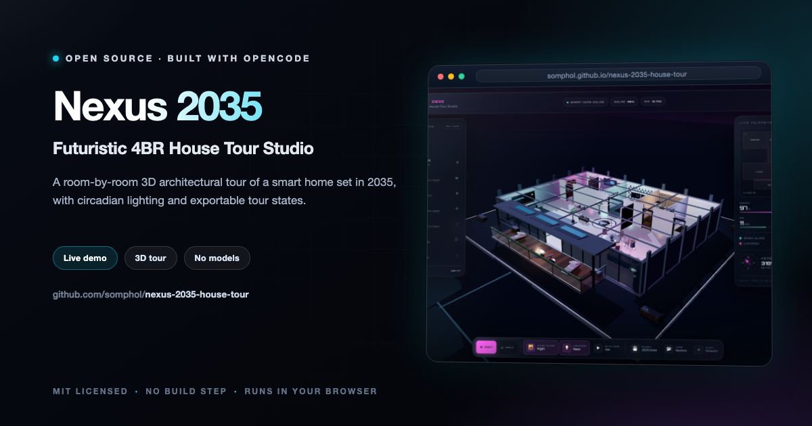

<div align="center">



# Nexus 2035

**Futuristic 4BR House Tour Studio**

An interactive, room-by-room 3D architectural tour of a four-bedroom smart home set in the year 2035.

[](https://somphol.github.io/nexus-2035-house-tour/)
[](LICENSE)

**[Try it live →](https://somphol.github.io/nexus-2035-house-tour/)**

</div>

---

## What's inside

| Space | Highlights |
| --- | --- |
| **Living & Kitchen** | Sunken sectional lounge, glass-top island with three glowing induction halos, geometric dining table, floating media wall, panoramic smart glass |
| **Master Suite** | Floating platform bed with under-bed circadian glow, upholstered feature wall, translucent bathroom partition, halo-lit vanity, freestanding bath |
| **AR Studio** | Dual curved 8K workstations, ergonomic chair, acoustic hex wall, glowing tech rack, floating shelves |
| **Eco Bedroom** | Warm timber slat wall, sealed terrarium biodomes, circadian pendants, natural-fibre bed |
| **Guest Suite** | Minimalist acoustic pod bed, wall-mounted cinema, quiet-luxury palette |
| **Central Foyer** | Volumetric Aura hologram projector, 48-cell hydroponic moss wall, terrazzo inlay with LED halo |
| **Sky Balcony** | Cantilevered deck, zero-ember fire lounge, sun loungers, observation telescope, railing herb planter, 2035 skyline |

The residence sits on a cantilevered architectural plinth above a procedural neon city, with low-rise city fabric, animated air traffic, a lighting-aware skyline, and a gradient sky that shifts through daylight, sunset, and cyberpunk night.

## Features

### 3D engine
- Fully procedural architecture and furniture — no external models or image assets
- Polished terrazzo, walnut, concrete, woven rugs, brushed metal, smart glass, and emissive LED materials generated at runtime
- Shadow-casting directional sun, room-by-room point lights, hemisphere ambient, and animated LED channels
- Open-roof "dollhouse" presentation for orbiting, plus first-person walk mode
- Responsive renderer with capped device pixel ratio and reduced shadow resolution on mobile

### Navigation
- **Room teleport drawer** with seven destinations and per-room metadata
- **Clickable floor-plan minimap** with live camera dot and heading line
- **Orbit mode** — drag to orbit, right-drag to pan, scroll to zoom, smooth damped controls
- **Walk mode** — WASD / arrow keys, Shift to boost, drag to look, wall and furniture collision
- Cinematic eased camera transitions, compass heading, live FPS, and tour banner
- **Auto Tour** cycles the residence every 8.2 seconds

### Smart-home controls
- **Smart glass** — Crystal Clear → Privacy Tint → Night Mode, animated material transitions
- **Circadian lighting** — Daylight White → Warm Evening Sunset → Cyberpunk Neon, with coordinated sky, sun, city glow, LED colours, room lights, exposure, and UI accent themes
- **Inspectable props** — hologram, master bed, kitchen island, hydro-wall, media wall, AR desk, terrarium, guest pod, vanity, and fire lounge each open a feature card with specifications and a "Focus View" camera move
- Object actions: cycle hologram spectrum, toggle under-bed glow, induction halos, and bio grow lights

### Persistence & portability
- Camera position, active room, lighting mode, glass tint, and pinned room presets auto-save to `localStorage`
- **💾 Export Tour Config** downloads `nexus2035_house_state.json`
- **📂 Load Tour Config** restores a tour state across devices
- **Pin View** saves the current camera angle as the active room's preset
- Reset returns the entire residence to its default state

## Run locally

No install or build required.

```bash
cd nexus-2035-house-tour
python3 -m http.server 8080
# then open http://localhost:8080
```

You can also open `index.html` directly, though a local server gives the most consistent browser behaviour.

Three.js r128 and OrbitControls are loaded from CDNs; Orbitron and Manrope are loaded from Google Fonts. Everything else is generated in-browser.

## Controls

| Input | Action |
| --- | --- |
| Drag | Orbit / look around |
| Scroll | Zoom |
| WASD / arrows | Walk (in Walk mode) |
| Shift | Boost walk speed |
| `1`–`7` | Teleport to room |
| `0` | Return to overview |
| `G` | Cycle smart glass |
| `L` | Cycle circadian lighting |
| `O` / `W` | Orbit / Walk mode |
| `T` | Toggle auto tour |
| `H` / `?` | Open help |
| `Esc` | Close panels |

Click the hologram, beds, kitchen island, hydro-wall, or other highlighted objects to inspect them.

## Project structure

```
.
├── index.html                 # UI shell, HUD, modals, loader
├── style.css                  # Glassmorphism design system + responsive layout
├── script.js                  # Three.js engine, architecture, props, state, interactions
├── state.json                 # Build state: elapsed time, token usage, credits
├── docs/                      # README screenshots
├── LICENSE
└── README.md
```

### Export state schema

```json
{
  "app": "nexus-2035",
  "version": 1,
  "settings": {
    "room": "living",
    "mode": "orbit",
    "lighting": "daylight",
    "glass": "clear"
  },
  "camera": { "position": [], "target": [], "yaw": 0, "pitch": 0 },
  "roomPresets": {
    "living": { "camera": [], "target": [] }
  }
}
```

## Build state

The build report lives in [`state.json`](state.json). It records the wall-clock and active build duration, the full token ledger for the session, verification results, and project credits.

## Credits

- **Studio / agent:** [OpenCode](https://opencode.ai)
- **Model:** DeepSeek V4.1 Flash (`opencode-go` provider)
- **3D engine:** [Three.js](https://threejs.org) r128 + OrbitControls
- **Type:** Orbitron and Manrope via Google Fonts
- **Design & code:** Generated in a single OpenCode session, with procedural geometry and canvas textures authored for this project

## Contributing

Contributions are welcome — bug reports, feature ideas, accessibility improvements, and
documentation fixes alike. Please read [CONTRIBUTING.md](CONTRIBUTING.md) and the
[Code of Conduct](CODE_OF_CONDUCT.md) before opening a pull request.

- **Found a bug?** [Open a bug report](https://github.com/somphol/nexus-2035-house-tour/issues/new?template=bug_report.yml)
- **Have an idea?** [Request a feature](https://github.com/somphol/nexus-2035-house-tour/issues/new?template=feature_request.yml)
- **Found a vulnerability?** Please follow [SECURITY.md](SECURITY.md) and report it privately.

## Documentation

| Document | Purpose |
| --- | --- |
| [README.md](README.md) | Overview, setup, controls, and architecture |
| [CHANGELOG.md](CHANGELOG.md) | Notable changes and release history |
| [CONTRIBUTING.md](CONTRIBUTING.md) | Local workflow, constraints, and pull request checks |
| [SECURITY.md](SECURITY.md) | Supported versions and private vulnerability reporting |
| [LICENSE](LICENSE) | MIT licence |

## License

MIT — see [LICENSE](LICENSE).
